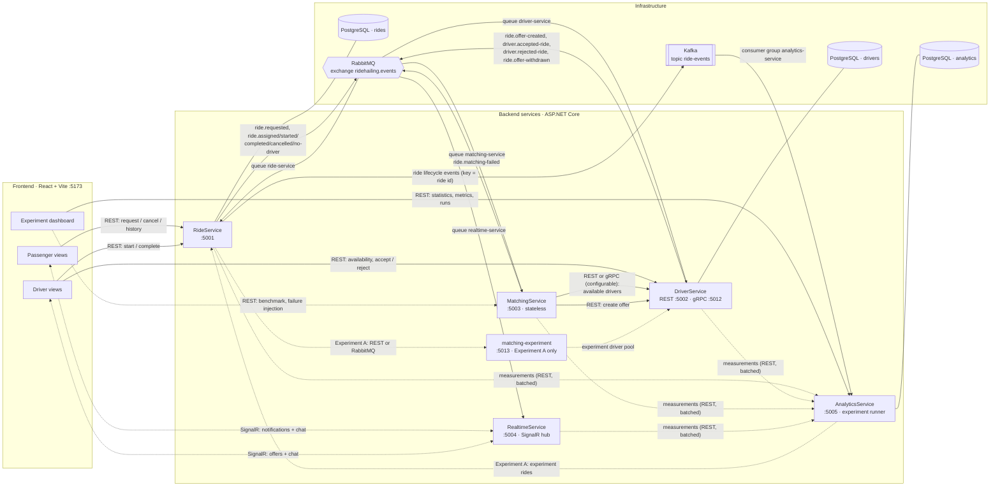
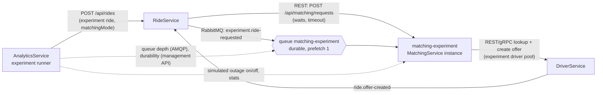
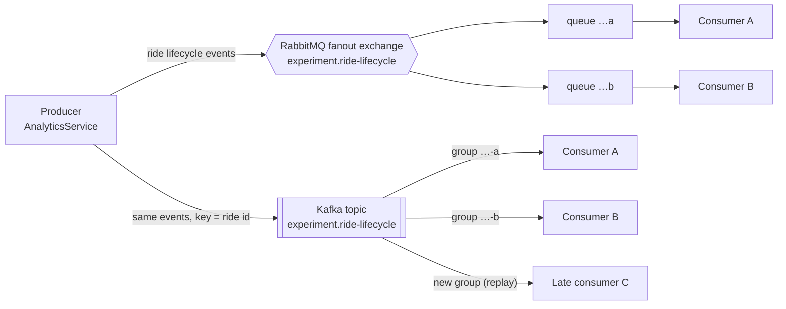

# Architecture

The system is a simplified ride-hailing platform made of **five independent ASP.NET Core services** (.NET 10), a **React frontend**, and three infrastructure components (**PostgreSQL, RabbitMQ, Kafka**). There is no API gateway: the frontend calls the service that owns the data directly.

## Architecture diagram (as implemented)



Solid lines are requests or messages of the ride workflow; dotted lines are real-time connections, experiments, experiment controls and metric reporting. The experiment paths are explained in detail below.

## Core application vs experimental alternatives

The application has **fixed communication decisions** (used by every demo ride). The research experiments add **alternatives for two specific interactions**, selectable per experiment run. Services cannot freely pick a technology for every interaction.

### Fixed decisions in the core application

| Interaction | Mechanism | Why (design choice) |
| --- | --- | --- |
| Frontend → owning service (request ride, accept, start, …) | REST | user actions need an immediate answer |
| Ride Service → Matching Service (initial matching) | **RabbitMQ** (`ride.requested`) — configurable to REST with `RIDE_MATCHING_MODE=Rest` | matching may take time or be unavailable; requests must not be lost (see Experiment A) |
| Matching Service → Driver Service: driver lookup | REST (gRPC switchable) | needs an immediate answer to continue matching |
| Matching Service → Driver Service: create offer | REST | needs to know immediately whether the driver was still available |
| Workflow events between services (offer, accept, reject, status changes) | RabbitMQ | each event has a specific consumer that must act on it |
| Ride lifecycle facts → analytics | Kafka (`ride-events`) | independent consumer, history kept, replayable (see Experiment B) |
| Services → browsers | SignalR | server push, chat |

### Experiment A: alternative paths for Ride Service → Matching Service



- Same code as the main MatchingService, started with `Matching__Instance=Experiment`: it consumes only `matching-experiment`, offers rides only to the 20 hidden experiment drivers and can simulate unavailability (`PUT /api/experiments/simulated-outage`). It can also be stopped for real (`docker compose stop matching-experiment`) without affecting demo rides.
- Each ride uses exactly **one** path (stored as `Ride.MatchingMode`). Offer creation is idempotent (request key = message id or `rest:<rideId>`).
- RideService records when the first offer was created (`Ride.OfferCreatedAt`, from `ride.offer-created`), so a ride that is *Requested without an offer* is visibly **pending**.
- REST failure (timeout, unreachable, 503): RideService cancels the ride with the reason and returns 503; the cancellation makes DriverService refuse/withdraw any late offer.

### Experiment B: event distribution through RabbitMQ or Kafka



The application's own exchange and topic are not used. Queues and consumer groups are created per run and removed afterwards. Producer and consumers run inside AnalyticsService (one process → one monotonic clock for delivery latency); each consumer has its own queue/group, so the broker treats them as independent services.

## Services and data ownership

| Service | Port | Responsibility | Data |
| --- | --- | --- | --- |
| **RideService** | 5001 | Ride requests and the ride lifecycle (state machine). Publishes workflow events to RabbitMQ and lifecycle events to Kafka. | `rides` DB: rides, outbox, processed messages |
| **DriverService** | 5002 (REST), 5012 (gRPC) | Drivers, availability, ride offers (create, accept, reject, expire). Hosts the REST **and** gRPC driver-availability lookup. | `drivers` DB: drivers (6 seeded), offers, closed rides, outbox, processed messages |
| **MatchingService** | 5003 | Matches ride requests to drivers: looks up available drivers (REST or gRPC), creates an offer, re-matches after a rejection, reports when no driver is found. Also hosts the REST/gRPC benchmark. | none (stateless) |
| **RealtimeService** | 5004 | SignalR hub `/hubs/rides`: pushes workflow events to the right passenger/driver, two-way chat per ride, delivery acknowledgements. | in memory only (connections, recent chat) |
| **AnalyticsService** | 5005 | (A) consumes Kafka ride events → business statistics; (B) stores measurements, experiment runs, findings and trade-off notes, and **runs the scenario experiments** A and B. Serves the Experiment Dashboard. | `analytics` DB: ride events, measurements, experiment runs, scenario findings, trade-off notes |
| **matching-experiment** | 5013 | Second instance of MatchingService, only for Experiment A (own queue, experiment driver pool, simulated outage). | none |

A service never reads another service's tables. One PostgreSQL container hosts three separate databases (`docker/postgres/init-databases.sql`); EF Core migrations are applied automatically at service start-up.

## Ride lifecycle

```
RideService (Ride)        Requested ──► Assigned ──► InProgress ──► Completed
                             │  │          │
                             │  └──► Cancelled ◄┘
                             └──► NoDriverAvailable

DriverService (Driver)    Offline ⇄ Available ──offer──► Offered ──accept──► Busy ──completed/cancelled──► Available
                                          ▲                  │
                                          └─reject / expire──┘
```

All transitions go through methods on the entity (`Ride.Start`, `Driver.ReserveFor`, …) which throw on an invalid transition (HTTP 409) or a wrong actor (HTTP 403). Optimistic concurrency (PostgreSQL `xmin`) prevents two concurrent updates from overwriting each other, e.g. two offers reserving the same driver.

## Reliability patterns

| Pattern | Where | Why |
| --- | --- | --- |
| **Transactional outbox** | RideService, DriverService (`src/shared/.../Outbox`) | The business change and the event are saved in one DB transaction; a background dispatcher publishes them. No "saved but never published" state. |
| **Inbox / processed-message table** | RideService, DriverService | Consumers store the EventId of handled messages in the same transaction → duplicates are skipped. |
| **In-memory duplicate cache** | MatchingService, RealtimeService | Stateless services remember recent EventIds. |
| **Idempotency key** | `POST /api/offers` (`RequestKey` = id of the triggering message) | A redelivered message never creates a second offer. |
| **Publisher confirms + persistent messages + durable queues** | RabbitMQ publisher | A publish only succeeds once the broker has stored the message. |
| **Manual ack, retry with back-off, dead-letter queue** | RabbitMQ consumer (`RabbitMqConsumer<T>`) | Failed messages are retried 3× (via `x-retry-count`), then moved to `<queue>.dlq`. |
| **Kafka `acks=all` + idempotent producer; manual offset commit** | RideService / AnalyticsService | At-least-once delivery; AnalyticsService ignores duplicates via a unique EventId index. |
| **Offer expiry** | DriverService `OfferExpiryService` | An unanswered offer expires after 30 s and the ride is re-matched. |
| **Correlation ids** | Every message envelope, `X-Correlation-ID` header | All messages of one ride workflow share one CorrelationId (also visible in logs and measurements). |

## Code structure

```
src/
├── shared/RideHailing.Shared/       Code used by all services
│   ├── Contracts/                   Message payload records (the contract between services)
│   ├── Messaging/                   Envelope, event types, RabbitMQ topology/publisher/consumer
│   ├── Outbox/                      Transactional outbox + inbox (EF Core)
│   ├── Metrics/                     Measurement reporter + experiment run contracts
│   └── Hosting/                     DI helpers, API exception → ProblemDetails mapping
└── services/<Service>/
    ├── Controllers/                 REST endpoints (thin)
    ├── Models/                      Entities with their rules + DTOs
    ├── Services/                    Application logic (independent of the transport)
    ├── Messaging/                   RabbitMQ handlers, Kafka producer/consumer
    ├── Data/                        DbContext + migrations   (Ride, Driver, Analytics)
    ├── Hubs/                        SignalR hub               (Realtime)
    └── Protos/                      gRPC contract             (Driver; MatchingService compiles the client from it)
```

The shared library only contains infrastructure plumbing and contracts; business rules stay in the services.

## Networking

| Context | Infrastructure | Other services |
| --- | --- | --- |
| Service runs on the host (`dotnet run`) | `localhost:5432`, `localhost:5672`, `localhost:9092` | `localhost:500x`, gRPC `localhost:5012` |
| Service runs in Docker Compose | `postgres:5432`, `rabbitmq:5672`, `kafka:19092` | `<service-name>:8080`, gRPC `driver-service:8081` |

Kafka exposes two listeners (`kafka:19092` for containers, `localhost:9092` for the host). DriverService has two Kestrel endpoints because without TLS one port cannot serve both HTTP/1.1 (REST) and HTTP/2 (gRPC). The host ports are the same in both modes, so the frontend configuration never changes.
