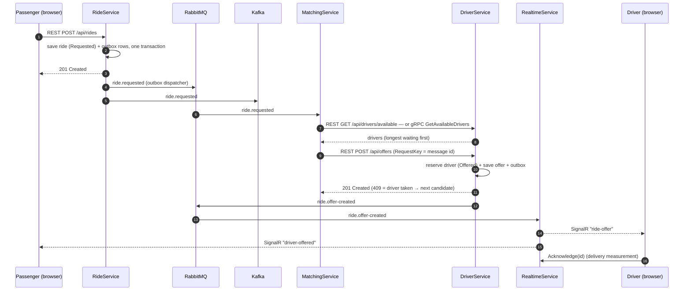
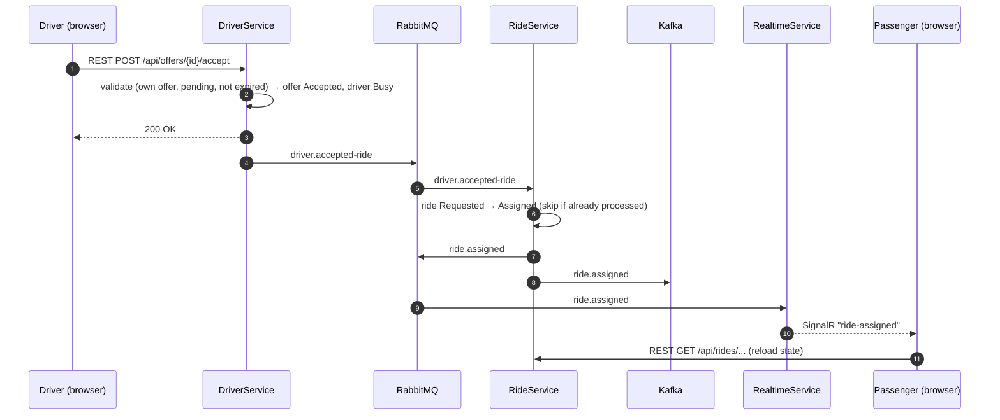

# Communication

Which mechanism is used for which operation, and why. Every mechanism has one realistic role in the system rather than being used everywhere; that makes the comparison meaningful.

## Overview

| Mechanism | Style | Used for (implemented) | Why |
| --- | --- | --- | --- |
| **REST** (HTTP/1.1 + JSON) | synchronous request/response | All frontend actions (request/cancel ride, availability, accept/reject, start/complete, dashboard data). MatchingService → DriverService: driver lookup (default) and offer creation. | Simple, universal, easy to debug; the baseline. |
| **gRPC** (HTTP/2 + Protobuf) | synchronous, binary, contract-first | MatchingService → DriverService **driver-availability lookup**, the exact equivalent of `GET /api/drivers/available`. Switch with `DriverLookup:Mode` (`Rest`/`Grpc`) or at runtime from the dashboard. | Typed contract (`driver_availability.proto`), smaller payloads, HTTP/2. Same operation as REST → directly comparable. |
| **RabbitMQ** | asynchronous messaging (topic exchange, one durable queue per consumer) | The ride workflow between services: request → matching → offer → accept/reject → status changes. | Decouples services in time; messages wait in the queue if a consumer is down; acks, retries, dead-lettering. |
| **Kafka** | asynchronous, append-only, replayable event log | Ride lifecycle events (`ride-events`, key = ride id) from RideService, consumed by AnalyticsService. | Events are kept; independent consumer groups; replay; ordering per ride. |
| **SignalR** (WebSocket) | persistent, bidirectional, server push | Notifications to passengers/drivers, two-way chat per ride, client acknowledgements. | The browser gets updates without polling; groups per user and per ride. |

Regular business actions never go through RealtimeService: it only pushes notifications and relays chat. Notifications are *signals*: the frontend reloads the authoritative state from the owning service via REST.

### RabbitMQ vs Kafka: why both?

- **RabbitMQ** carries *workflow messages* that one specific service must act on ("match this ride", "the driver accepted"). A message is removed once it is acknowledged.
- **Kafka** carries *facts* ("ride completed"). They stay in the log, so AnalyticsService (or any future consumer group) can read them independently and re-read history. RideService publishes lifecycle events to both: to RabbitMQ for the workflow and to Kafka for the event stream. Both go through the same transactional outbox.

## Message envelope

Every RabbitMQ and Kafka message is a JSON envelope (`src/shared/RideHailing.Shared/Messaging/MessageEnvelope.cs`):

```json
{
  "eventId": "…",          // unique per message → duplicate detection
  "eventType": "ride.requested",  // also the RabbitMQ routing key
  "correlationId": "…",    // same for every message of one ride workflow
  "causationId": "…",      // eventId of the message that caused this one
  "source": "ride-service",
  "occurredAt": "…",       // when the business fact happened
  "publishedAt": "…",      // set right before sending → start of delivery measurements
  "payload": { … }         // see Contracts/RideContracts.cs
}
```

RabbitMQ messages additionally carry the AMQP properties `message_id`, `correlation_id`, `type` and `app_id`, which makes them easy to read in the management UI. Kafka records carry `event-type`, `event-id` and `correlation-id` headers.

## RabbitMQ topology

Exchange `ridehailing.events` (topic). Routing key = event type. Each consuming service has one durable queue with a dead-letter queue:

| Queue | Bound event types | Consumer |
| --- | --- | --- |
| `matching-service` | `ride.requested`, `driver.rejected-ride` | MatchingService |
| `ride-service` | `driver.accepted-ride`, `ride.matching-failed` | RideService |
| `driver-service` | `ride.completed`, `ride.cancelled` | DriverService |
| `realtime-service` | `ride.offer-created`, `driver.rejected-ride`, `ride.offer-withdrawn`, `ride.assigned`, `ride.started`, `ride.completed`, `ride.cancelled`, `ride.no-driver-available` | RealtimeService |
| `<queue>.dlq` | messages that failed 4 times (exchange `ridehailing.dead-letter`) | — (inspect in the UI) |

Every service declares the whole topology on start-up (`RabbitMqTopology.cs`), so a queue exists and buffers messages even before its consumer has started.

## Flows

### 1. Passenger requests a ride, matching, driver receives the offer



### 2. Driver accepts, passenger is notified



### 3. Start and complete

The assigned driver calls `POST /api/rides/{id}/start` and `/complete` on RideService (REST). RideService checks the driver and the transition, then publishes `ride.started` / `ride.completed` to RabbitMQ (→ RealtimeService notifies both parties; DriverService frees the driver on completion) and to Kafka.

### 4. Rejection, expiry and "no driver available"

- Reject (`POST /api/offers/{id}/reject`) or expiry after 30 s → DriverService frees the driver and publishes `driver.rejected-ride` with the ride details and the ids of all drivers already tried.
- MatchingService re-matches excluding those drivers (attempt + 1). After 3 offers, or when no driver is left, it publishes `ride.matching-failed`.
- RideService marks the ride `NoDriverAvailable` and publishes `ride.no-driver-available` → the passenger is notified.

### 5. Cancellation

`POST /api/rides/{id}/cancel` (passenger; allowed while Requested or Assigned) → `ride.cancelled`. DriverService withdraws pending offers (`ride.offer-withdrawn` → the driver is notified), frees the driver and remembers the ride as closed, so later offer requests get `410 Gone`. If a driver accepts a ride that was cancelled in the meantime, RideService answers with another `ride.cancelled` naming that driver, so DriverService releases them again.

### 6. Chat

Both browsers call `JoinRideChat(rideId)` on the hub (group `ride:<id>`), which returns the recent history. `SendChatMessage` stores the message in memory, pushes it to the *other* members of the group and returns it to the sender. The receiver acknowledges it, which yields a SignalR delivery measurement.

### 7. Analytics

AnalyticsService consumes `ride-events` in consumer group `analytics-service`, stores each event (unique EventId) and commits the offset afterwards. The dashboard shows statistics, the stored event history, per-partition offsets and lag, and can read the topic with a brand-new consumer group to demonstrate independent consumption.

## Event catalogue

| Event type | Channel | Producer → consumers | Payload |
| --- | --- | --- | --- |
| `ride.requested` | RabbitMQ + Kafka | RideService → MatchingService, AnalyticsService | `RideRequestedPayload` |
| `ride.offer-created` | RabbitMQ | DriverService → RealtimeService, RideService (records when matching produced an offer) | `RideOfferCreatedPayload` |
| `driver.accepted-ride` | RabbitMQ | DriverService → RideService | `DriverAcceptedRidePayload` |
| `driver.rejected-ride` | RabbitMQ | DriverService → MatchingService, RealtimeService | `DriverRejectedRidePayload` |
| `ride.offer-withdrawn` | RabbitMQ | DriverService → RealtimeService | `RideOfferWithdrawnPayload` |
| `ride.matching-failed` | RabbitMQ | MatchingService → RideService | `RideMatchingFailedPayload` |
| `experiment.ride-requested` | RabbitMQ | RideService → matching-experiment (Experiment A only) | `RideRequestedPayload` (with `ExperimentRunId`) |
| `ride.assigned`, `ride.started`, `ride.completed`, `ride.cancelled`, `ride.no-driver-available` | RabbitMQ + Kafka | RideService → RealtimeService, DriverService (completed/cancelled), AnalyticsService | `RideStatusChangedPayload` |

How each mechanism is measured is described in [experiments.md](experiments.md).

## Experimental alternatives (research)

The core application uses the mechanisms above. For the research, two interactions have a controlled alternative (see [architecture.md](architecture.md#core-application-vs-experimental-alternatives) and [experiments.md](experiments.md)):

- **Experiment A — Ride Service → Matching Service:** RabbitMQ (`ride.requested` / `experiment.ride-requested`, asynchronous) **or** REST `POST /api/matching/requests` (synchronous, with timeout). The choice is made per ride (`matchingMode`); experiment rides use a dedicated matching instance and driver pool. For normal rides the default is RabbitMQ (`RIDE_MATCHING_MODE`).
- **Experiment B — ride lifecycle event distribution:** the same events through a RabbitMQ fanout exchange with a queue per subscriber, **or** a Kafka topic with a consumer group per subscriber, on dedicated experiment resources.
